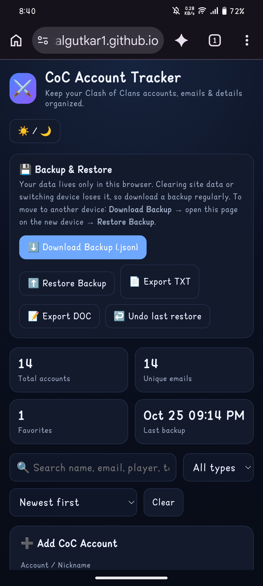

# 🏰 COC Account Tracker

Keep all your Clash of Clans accounts in one place. Everything is saved **locally** on your device, so nothing is uploaded anywhere.

▶️ **[Open the tracker]([add your live link here])**

## 📸 Screenshots

## ✨ Features

- Save multiple Clash of Clans accounts
- Data stays on your device (local storage)
- [Feature, e.g. track Town Hall level per account]
- [Feature, e.g. add notes for each account]
- [Feature, e.g. edit or delete accounts]

## 📖 How to use

1. Open the tracker.
2. [e.g. Tap "Add account" and enter the account details.]
3. [e.g. Tap an account to view or edit it.]

## 🔒 Privacy

Your account info is stored only in your browser or on your device. Clearing your browser data may erase it, so [e.g. back up important details elsewhere].

## 🛠️ Built with

[e.g. HTML, CSS, JavaScript]

## 🗺️ Roadmap

- [ ] [Next feature, e.g. export/import accounts]
- [ ] [Another idea]

## 🐞 Feedback

Found a bug or have an idea? Open an [issue](https://github.com/Rohitkalgutkar1/COC-Account-Tracker/issues/).

---

*Not affiliated with Supercell. Clash of Clans is a trademark of Supercell.*
